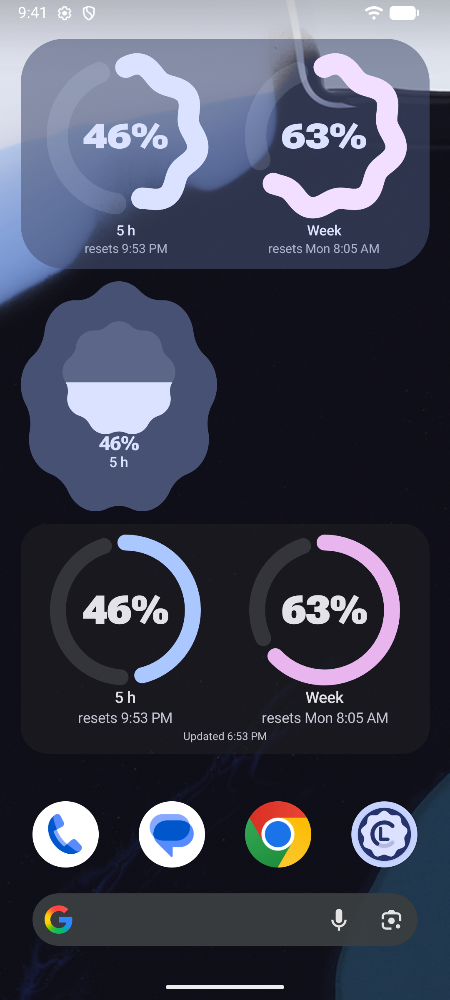
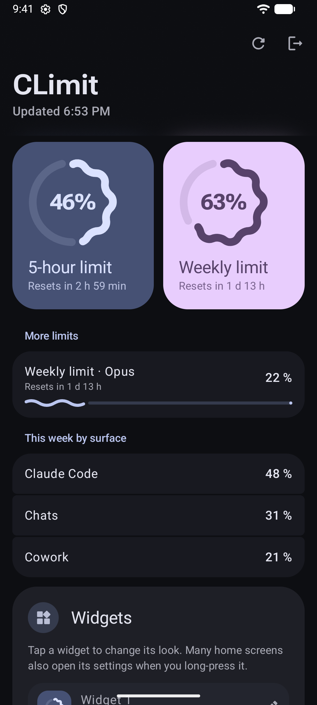
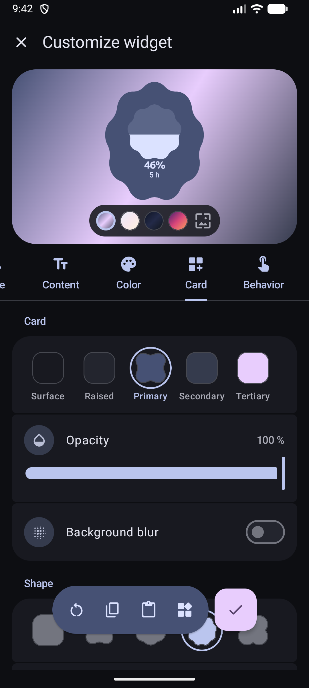

<p align="center">
  <picture>
    <source media="(prefers-color-scheme: dark)" srcset="docs/images/logo-dark.svg">
    
  </picture>
</p>

<h1 align="center">CLimit</h1>

<p align="center">
  Your Claude usage limits on the Android home screen.<br>
  Material 3 Expressive widgets for the 5-hour, weekly and per-model limits.
</p>

<p align="center">
  <a href="https://github.com/ProfessorQuantumUniverse/CLimit/releases/latest"><b>Download</b></a>
  &nbsp;&middot;&nbsp;
  <a href="#privacy">Privacy</a>
  &nbsp;&middot;&nbsp;
  <a href="#building">Building</a>
</p>

<p align="center">
  
  
  
  
</p>

## Features

- **Twelve styles**: rings, wavy rings, nested rings, gauge, bars, wavy bars, segments, dots, filling Material shapes, fill tiles, numbers and a combined view.
- **Any size**, from a single cell to tablet width. Small widgets switch to a one-limit layout.
- **Shapes and colour**: a rounded card or a Material shape (cookie, clover, sunny, pill ...), wallpaper colours or your own hue, light or dark, colours that change with the level.
- **Details you can tune**: type weight and width, labels, reset time as a clock or countdown, used or remaining, time progress of the window, padding, outline, opacity.
- **Presets**, saved looks, copying settings between widgets, export and import as text.
- **Live preview** while you drag a slider, on a sample background or a photo of your own.
- **Background blur** on Samsung One UI Home 7 and later.
- English and German.

Requires Android 12 or newer.

## Install

Grab the APK from the [latest release](https://github.com/ProfessorQuantumUniverse/CLimit/releases/latest), sign in once with your claude.ai email and the code you receive, then add a widget from the app or your launcher's widget picker. Widgets refresh every 15 minutes, or when tapped.

Google sign-in is not supported; use the email code.

## Privacy

- Sign-in happens on claude.ai in a locked-down WebView. Afterwards all WebView data is wiped.
- The session cookie is encrypted with AES-256-GCM. The key lives in the Android Keystore (StrongBox where available) and cannot be exported.
- The cookie is only ever sent to claude.ai: HTTPS only, system certificates only, redirects are not followed.
- No analytics, no trackers, no Google Play Services. The only permission is `INTERNET`. Backups and device transfer are disabled.

## Building

JDK 17 and the Android SDK (platform 37) are needed.

```bash
./gradlew assembleRelease
```

The release APK is unsigned unless a `keystore.properties` exists (see [keystore.properties.example](keystore.properties.example)). Tests run with `./gradlew testDebugUnitTest`.

Debug builds have a demo mode for screenshots: put a usage response like [usage_pro.json](app/src/test/resources/usage_pro.json) at `files/demo_usage.json` in the app's data directory.

## Notes

CLimit is not made by or affiliated with Anthropic. Claude is a trademark of Anthropic. The app reads the same usage data the claude.ai website shows; that interface is undocumented and may change at any time.

## Licence

GPL-3.0-or-later, see [LICENSE](LICENSE).
Roboto Flex is &copy; The Roboto Flex Project Authors, under the [SIL Open Font License 1.1](LICENSES/OFL-1.1-RobotoFlex.txt).
The Samsung blur attributes follow [blur-widget-demo](https://github.com/thatjoshguy67/blur-widget-demo) (MIT).
