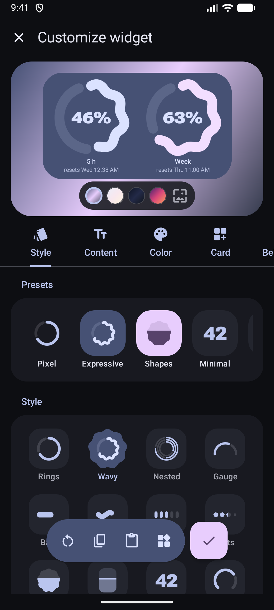

# CLimit

Material 3 Expressive home screen widgets for your Claude usage: the 5-hour and weekly limits, when they reset, and the per-model weekly limit — in twelve styles, at any size, tuned to the last detail.

<p>
  
  
  
  
</p>

> CLimit is not made by or affiliated with Anthropic. Claude is a trademark of Anthropic.
> The app reads the same usage data the claude.ai website shows; that interface is undocumented and may change at any time.

## Features

- **Twelve styles** — rings, wavy rings, nested rings, gauge, bars, wavy bars, segments, dots, filling Material shapes, fill tiles, numbers, combo.
- **Any size** — from one cell to tablet width. Small widgets switch to a single-limit layout on their own.
- **Widget shapes** — a rounded rectangle or a Material shape (cookie, clover, sunny, puffy, pill, arch, slanted, ghostish …) stretched to the widget.
- **Colour** — wallpaper (Material You), eight seed palettes or any hue; light, dark or system; per-limit, single or level-based gauge colours with adjustable thresholds.
- **Card** — seven colour roles, opacity, corner radius, outline, padding, spacing.
- **Type** — numbers in Roboto Flex with adjustable weight and width, or the system font; label and reset-line sizes; clock time or countdown; percent sign; used or remaining.
- **Time progress** — an optional thin second gauge for how much of the 5-hour or weekly window has passed.
- **Behaviour** — tap to refresh, open CLimit, open Claude, open the widget's settings, or nothing; show the last update; mark data older than an hour.
- **Presets** — twelve built-in looks, your own saved looks, copy settings from another widget, export/import as text.
- **Live preview** — the real widget, rendered while you drag a slider, on a sample background or a photo of your choice.
- **Background blur on Samsung** — One UI Home 7+ blurs the wallpaper behind a translucent card. On other launchers the card just stays translucent (a hint in the settings says so).
- English and German, per-app language, themed icon, predictive back, tablet layout.

## Privacy and security

- Sign-in happens on claude.ai (email + code) in a locked-down WebView: claude.ai only, no JavaScript bridge, screenshots blocked, all WebView data wiped afterwards.
- The session cookie is encrypted with AES-256-GCM; the key lives in the Android Keystore (StrongBox where available) and cannot be exported.
- Backup and device transfer are disabled. No analytics, no trackers, no Google Play Services. The only permission is `INTERNET`.
- Network: HTTPS only, system CAs only, redirects not followed, so the cookie can only ever go to claude.ai.

The cookie is not bound to biometrics because widgets refresh in the background. On a rooted or otherwise compromised device it cannot be protected — true for any app of this kind.

## Building

Requirements: JDK 17, Android SDK with platform 37.

```bash
./gradlew assembleRelease
```

The release APK is unsigned (F-Droid signs its own builds). Tests: `./gradlew testDebugUnitTest`.

Debug builds have a demo mode for screenshots and testing without an account: put a usage response (see `app/src/test/resources/usage_pro.json`) at `files/demo_usage.json` in the app's data directory.

## F-Droid

Store texts and screenshots are in `fastlane/metadata/android`. Expected anti-feature: **NonFreeNet** (depends on claude.ai).

## Licence

GPL-3.0-or-later, see [LICENSE](LICENSE).
Roboto Flex is © The Roboto Flex Project Authors, under the SIL Open Font License 1.1 ([LICENSES/OFL-1.1-RobotoFlex.txt](LICENSES/OFL-1.1-RobotoFlex.txt)).
The Samsung blur attributes follow [blur-widget-demo](https://github.com/thatjoshguy67/blur-widget-demo) (MIT).
